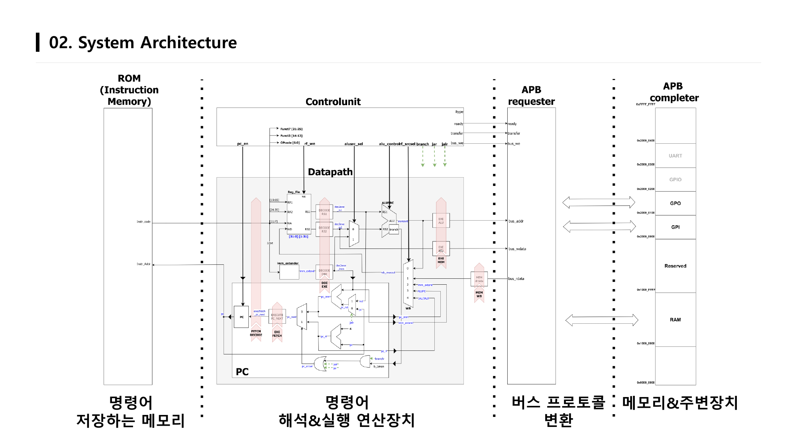
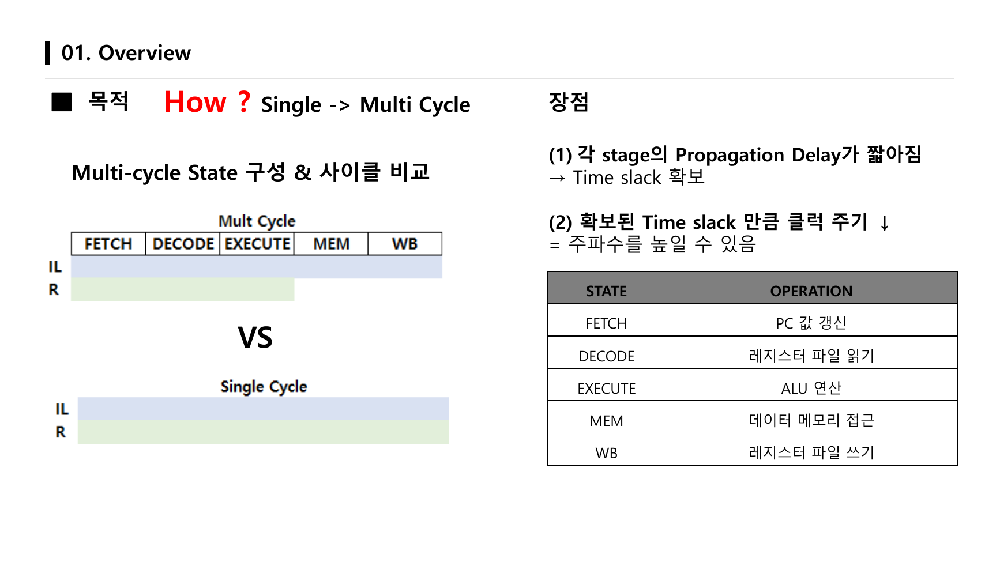
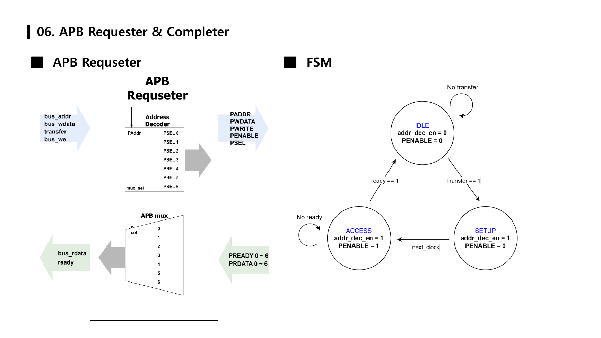
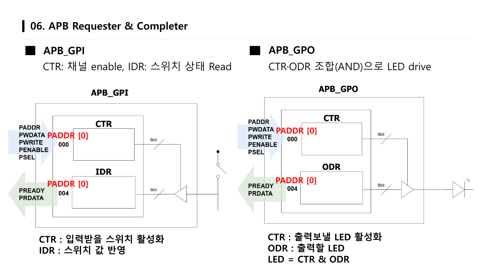
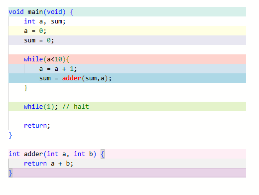
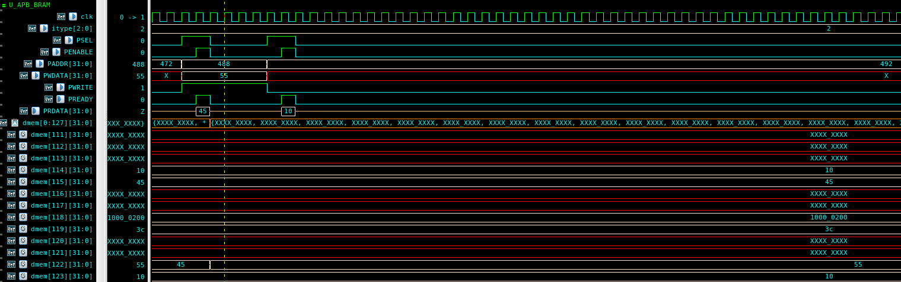
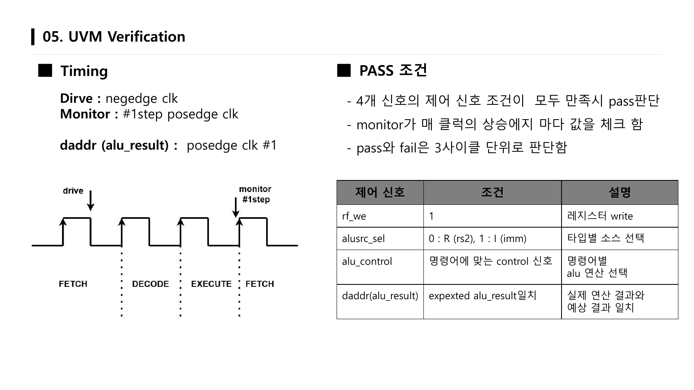
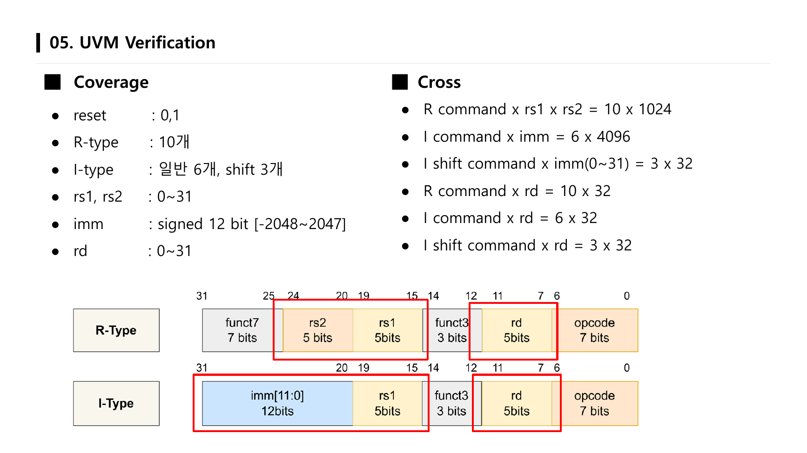
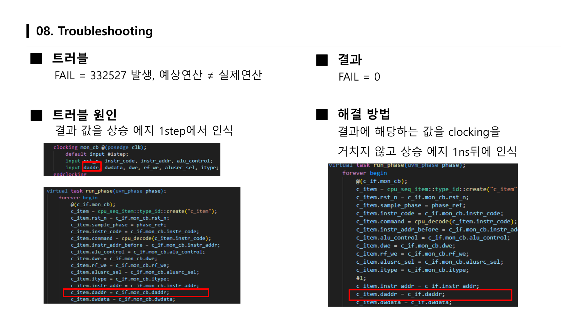

# RV32I Multi-Cycle CPU with APB Bus

SystemVerilog로 설계한 **RISC-V RV32I 멀티사이클 CPU**와 **AMBA APB 버스 시스템**입니다.
CPU의 메모리 접근을 APB Requester가 APB 프로토콜로 변환하고, 주소 디코딩을 거쳐 BRAM·GPI·GPO 등 주변장치(Completer)와 통신합니다.
C 코드를 RV32I 기계어로 바꿔 실제로 실행하고, 그 결과가 APB 버스를 통해 BRAM에 저장되는 것까지 검증했습니다.

> 4인 팀 프로젝트 (2026.09)
> **담당: CPU SW 검증** (C 코드 → 기계어 실행, 명령어별 파형 분석)
>
> 📑 발표 자료: [docs/RV32I_SoC_Final_Presentation.pdf](docs/RV32I_SoC_Final_Presentation.pdf)

| 역할 | 담당 |
|---|---|
| RV32I Multi-Cycle CPU 설계 및 검증 | 팀원 |
| CPU UVM 검증 | 팀원 |
| APB Requester & Completer 설계 및 검증 | 팀원 |
| **CPU SW 검증** | **본인** |

## System Overview



### System Flow

위 블록 다이어그램의 왼쪽에서 오른쪽으로, 명령어 하나가 이렇게 처리됩니다.

1. **Instruction ROM (명령어 저장 메모리)**
   PC가 가리키는 주소의 명령어(`instr_code`)를 꺼냅니다. ROM과 메모리·주변장치 접근 신호가 분리된 하버드 구조라서, 둘을 동시에 접근할 수 있습니다.
2. **Control Unit (명령어 해석)**
   opcode를 해석하고 `FETCH → DECODE → EXECUTE → MEM → WB` FSM을 돌면서 단계마다 `pc_en`, `rf_we`, `alu_srcsel`, `rf_srcsel`, `bus_we` 같은 제어 신호를 만듭니다. Load/Store가 아닌 명령어는 MEM 단계를 건너뜁니다.
3. **Datapath (실행 연산 장치)**
   레지스터 파일 읽기, 즉치값 생성, ALU 연산, 분기 판정, PC 갱신을 하고, 결과를 WB 단계에서 레지스터 파일에 씁니다.
4. **APB Requester (버스 프로토콜 변환)**
   Load/Store일 때 CPU의 `bus_addr`, `bus_wdata`, `transfer`, `bus_we`를 받아 `IDLE → SETUP → ACCESS` 순서의 APB 전송으로 바꿉니다. 주소 상위 4비트로 RAM과 주변장치를 구분하고, `PSEL0~6` 중 하나를 선택합니다.
5. **APB Completer (메모리 & 주변장치)**
   선택된 BRAM·GPI·GPO가 `PREADY`/`PRDATA`로 응답하면, Mux가 그 값만 CPU로 돌려줍니다. CPU는 `ready`를 받은 뒤 다음 단계로 넘어갑니다.

## 왜 멀티사이클인가



- **Why?** 싱글사이클 CPU는 가장 긴 Critical Path(Load 명령어) 기준으로 클럭 주기가 고정되어, 짧은 명령어(R-type 등)일수록 Time slack을 손해 봅니다.
- **How?** 명령어 하나를 5단계로 나누면 각 단계의 전파 지연이 짧아져 Time slack을 확보하고, 그만큼 클럭 주기를 줄여 **주파수를 높일 수 있습니다.**

| State | 동작 |
|---|---|
| FETCH | PC 값 갱신, 명령어 인출 (`pc_en = 1`) |
| DECODE | 레지스터 파일 읽기, 명령어 해석 |
| EXECUTE | ALU 연산, 주소 계산, 분기 판정 |
| MEM | APB 버스를 통한 데이터 메모리/주변장치 접근 (Load/Store만) |
| WB | 레지스터 파일 쓰기 |

### 주요 제어 신호

| 신호 | 설명 |
|---|---|
| `pc_en` | PC 레지스터 갱신 enable (FETCH에서만 1) |
| `rf_we` | 레지스터 파일 쓰기 enable |
| `alu_srcsel` | ALU 두 번째 입력 선택 (0 = rs2, 1 = immediate) |
| `rf_srcsel` | WB_MUX 선택, 레지스터 파일에 쓸 값 선택 |
| `branch`, `jal`, `jalr` | Branch / JAL / JALR 명령어 표시 |
| `bus_we`, `bus_addr`, `bus_wdata` | APB 쓰기 여부, ALU가 계산한 주소, 저장할 값(rs2) |
| `ready`, `bus_rdata` | APB 트랜잭션 완료, APB에서 읽어 온 데이터 |

## 지원 명령어

| Type | 명령어 |
|---|---|
| R | ADD, SUB, SLL, SLT, SLTU, XOR, SRL, SRA, OR, AND |
| I | ADDI, SLTI, SLTIU, XORI, ORI, ANDI, SLLI, SRLI, SRAI, JALR |
| IL (Load) | LB, LH, LW, LBU, LHU |
| S (Store) | SB, SH, SW |
| B | BEQ, BNE, BLT, BGE, BLTU, BGEU |
| U | LUI, AUIPC |
| J | JAL |

### 명령어 타입별 시뮬레이션

명령어를 직접 인코딩해 Instruction ROM에 넣고, 타입별로 결과를 파형에서 확인했습니다.

| Type | 시나리오 | 결과 |
|---|---|---|
| R | `reg[1] = 3`, `reg[2] = 4`로 초기화 후 10개 명령어 실행 | ADD 7, SUB −1, XOR 7, OR 7, AND 0, SLL 48, SRL 0, SLT/SLTU 1 |
| S | `reg[1] = −3`, `reg[2] = 4` 후 SB/SH/SW | `dwe`가 1일 때 주소에 저장, 다음 클럭 상승 엣지에 값 출력 |
| I | `ADDI x5, x0, 100` | write enable이 1일 때 x5에 100(`h'64`) 저장 |
| IL | `LW x6, 0(x0)` | 메모리의 100(`h'64`)을 x6에 저장 |
| B | `BNE x5, x6, 16` | 두 값이 같아 조건 False → `b_taken` low, PC + 4 |
| U | `LUI x8, 0x12345` | x8에 `0x12345000` 저장 |
| J | `JAL x9, 4` | PC가 24일 때 x9에 `0x1C`(24 + 4) 저장, Branch high로 점프 |

## 메모리 맵

| 주소 범위 | 영역 | 크기 |
|---|---|---|
| `0x1000_0000 ~ 0x1000_FFFF` | RAM (APB BRAM) | 64 KB |
| `0x1001_0000 ~ 0x1FFF_FFFF` | Reserved | 256 MB |
| `0x2000_0000 ~ 0x2000_00FF` | GPI | 256 B |
| `0x2000_0100 ~ 0x2000_01FF` | GPO | 256 B |
| `0x2000_0200 ~ 0x2000_02FF` | GPIO | 256 B |
| `0x2000_0300 ~ 0x2000_03FF` | UART | 256 B |

**스택 동작**: 프로그램 시작 시 `addi sp, zero, 512`로 스택 포인터를 초기화하고, 함수 진입 시 32바이트 스택 프레임을 잡아 `ra`, `s0`를 저장한 뒤 프레임 포인터(`s0 = 512`)를 설정합니다.

## APB Requester & Completer



- **Requester**: CPU 버스 신호를 받아 `IDLE → SETUP → ACCESS` FSM으로 APB 전송을 수행하고, 다음 SETUP 전까지 `PADDR`, `PWDATA`, `PWRITE`를 유지합니다.
- **Address Decoder**: 상위 4비트(`PADDR[31:28]`)로 RAM과 주변장치를 먼저 구분해 비교 로직을 단순화하고, 주변장치는 `PADDR[11:8]`로 `PSEL1~6`을 선택합니다.
- **Mux**: 선택된 Completer의 `PREADY`/`PRDATA`만 CPU로 전달합니다.
- **BRAM Completer**: `itype`에 따라 byte/half/word 단위로 쓰고 읽습니다.



- **GPI**: CTR로 입력받을 스위치 채널을 켜고, IDR로 스위치 상태를 읽습니다.
- **GPO**: CTR로 출력할 LED 채널을 켜고, ODR에 출력값을 씁니다. `LED = CTR & ODR`

| 검증 항목 | 예상 동작 | 결과 |
|---|---|---|
| Requester STATE | `PSEL0 → PENABLE → ready` 순서로 1 | ✅ |
| Address Decode | BRAM 접근 시 `PSEL0`만 선택 | ✅ |
| Address/Data HOLD | 다음 SETUP 전까지 `PADDR`, `PWDATA` 유지 | ✅ |
| BRAM Write / Read | ACCESS에서 `PWRITE`에 따라 `dmem` 쓰기/읽기 | ✅ |
| GPI CTR Write / IDR Read | CTR = `ff` 후 스위치 값 `ff`를 IDR로 읽음 | ✅ |
| GPI → BRAM | 읽은 IDR 값을 `dmem[123]`에 저장 | ✅ |
| GPO CTR/ODR Write → LED | `h'55 & h'05 = h'05` 출력 | ✅ |

## 검증

### 1) SW 검증: C 코드 → 기계어 실행 (담당)

CPU는 C 같은 고수준 문법을 직접 이해하지 못하므로, C 코드를 RV32I 어셈블리와 기계어로 변환해 Instruction ROM(`rtl/rom_code_ex1.mem`)에 넣고 실행했습니다.



| 검증 항목 | 신호 | 예상 동작 | 확인 내용 |
|---|---|---|---|
| ① Jump | `jal`, `pc`, `imm_ext` | PC + imm으로 점프 | `j .L2`(`jal x0, 32`)로 PC 32 + imm 32 = 64로 점프 |
| ② Bge | `branch`, `alu_control`, `rs1`, `rs2` | rs1, rs2 비교 후 조건에 따라 이동 | `lw a4` → `addi a5, 9` → `ble a4, a5, L3`에서 9 ≥ 0이라 PC − 32로 분기 |
| ③ a++ | `addi`, `alu_result`, `PADDR`, `PWDATA` | 메모리의 a를 읽어 1 증가 후 저장 | `lw a5, -20(s0)` → `addi a5, a5, 1` → `sw`로 `dmem[123]`(= 492/4)에 저장 |
| ④ Result | `PADDR`, `PWDATA`, `PWRITE` | 10회 반복 후 sum 주소에 누적합 저장 | **`dmem[122]`(= 488/4)에 55 저장** |
| ⑤ Loop | `instr_addr`, `pc`, `pc_imm` | `while(1)` 진입 후 PC 고정 | 분기 False → `b_taken` low, PC가 `0x4C`에 고정 |



명령어별 파형은 [`docs/images/apb_sw_verification/waveform`](docs/images/apb_sw_verification/waveform)에 있습니다.

### 2) UVM 검증



- **대상**: R/I 타입 명령어 총 19개. 레지스터 값이 x나 0이면 신뢰할 수 있는 검증이 아니라고 보고, 각 명령어 전에 `init_sequence`로 reset과 레지스터 초기값을 설정
- **Timing**: Driver는 negedge clk, Monitor는 posedge clk `#1step`, `daddr`(alu_result)는 posedge clk `#1`
- **PASS 조건**: `rf_we`, `alusrc_sel`, `alu_control`, `daddr`(alu_result) 4개 신호가 모두 기대값과 같으면 PASS, 3사이클 단위로 판정



- **Coverage**: reset, R-type 10개, I-type 일반 6개 + shift 3개, rs1·rs2·rd 0~31, imm signed 12bit
- **Cross**: R × rs1 × rs2(10 × 1024), I × imm(6 × 4096), I shift × imm 0~31(3 × 32), 명령어 × rd
- **시나리오**: 모든 조합을 채우는 데 필요한 평균 횟수(R ≈ 7,689 / I ≈ 36,434 / I shift ≈ 130)의 약 2배로 실행
- **결과**: (15,000 × 9) + (65,000 × 6) + (300 × 3) + 레지스터 초기화 589 = **PASS 541,489, 예상값과 일치, Coverage 100% 달성**

## 트러블슈팅: UVM에서 대량 FAIL 발생



| | 결과 |
|---|---|
| Before | **FAIL = 332,527**, 예상 연산 ≠ 실제 연산 |
| After | **FAIL = 0** |

- **원인**: 모니터가 결과 값(`daddr`)을 clocking block으로 상승 엣지 `#1step`에서 샘플링해서, 이번 명령어의 결과가 아니라 반영되기 전의 값을 읽음
- **해결**: 결과 값만 clocking block을 거치지 않고 **상승 엣지 1ns 뒤**에 인터페이스에서 직접 읽도록 바꿈

## 결론 및 고찰

**결론**
- C 코드 기반 누적 sum이 APB Bus를 통해 BRAM에 저장되는 것을 확인
- pass count 541,489가 예상값과 일치하고, 계획한 coverage 100% 달성

**고찰**
- 동작과 관계없는 신호들이 High가 되는 것을 확인 → 향후 전력 소비를 줄이는 최적화 필요
- APB Requester/Completer를 GPIO, UART 확장까지 고려해 설계
- Coverage 구성이 불완전함. R-type은 레지스터(rs1, rs2) 접근보다 모든 값의 연산 여부를 확인할 필요가 있어, Coverage 조건을 확장해 검증 신뢰성을 높일 예정

## 디렉터리 구조

```
rv32i-cpu-project
├── rtl/                     # 최종 설계 (멀티사이클 CPU + APB)
│   ├── rv32i_top.sv         # Top: ROM + CPU + APB Requester + BRAM
│   ├── control_unit.sv      # 멀티사이클 FSM, 제어 신호 생성
│   ├── datapath.sv          # PC, 레지스터 파일, ALU, 즉치 생성기
│   ├── instruction_rom.sv
│   ├── apb_requester.sv     # APB Requester, 주소 디코더, Mux
│   ├── apb_bram.sv          # APB BRAM Completer
│   ├── pkg/rv32i_pkg.sv     # opcode / 명령어 / state enum
│   └── *.mem                # 실행할 기계어
├── tb/tb_rv32i.sv
├── history/
│   ├── single_cycle/        # 싱글사이클 RV32I (이전 단계)
│   └── multi_cycle_draft/   # 멀티사이클 초기 버전
├── docs/
│   ├── RV32I_SoC_Final_Presentation.pdf
│   └── images/
├── Makefile
└── pkg.f
```

## 시뮬레이션

Synopsys VCS + Verdi 환경 기준입니다.

```bash
make run     # 컴파일
make simv    # 시뮬레이션 실행 (wave.fsdb 생성)
make verdi   # 파형 확인
make clean
```

## 개발 환경

SystemVerilog, UVM, Synopsys VCS / Verdi
